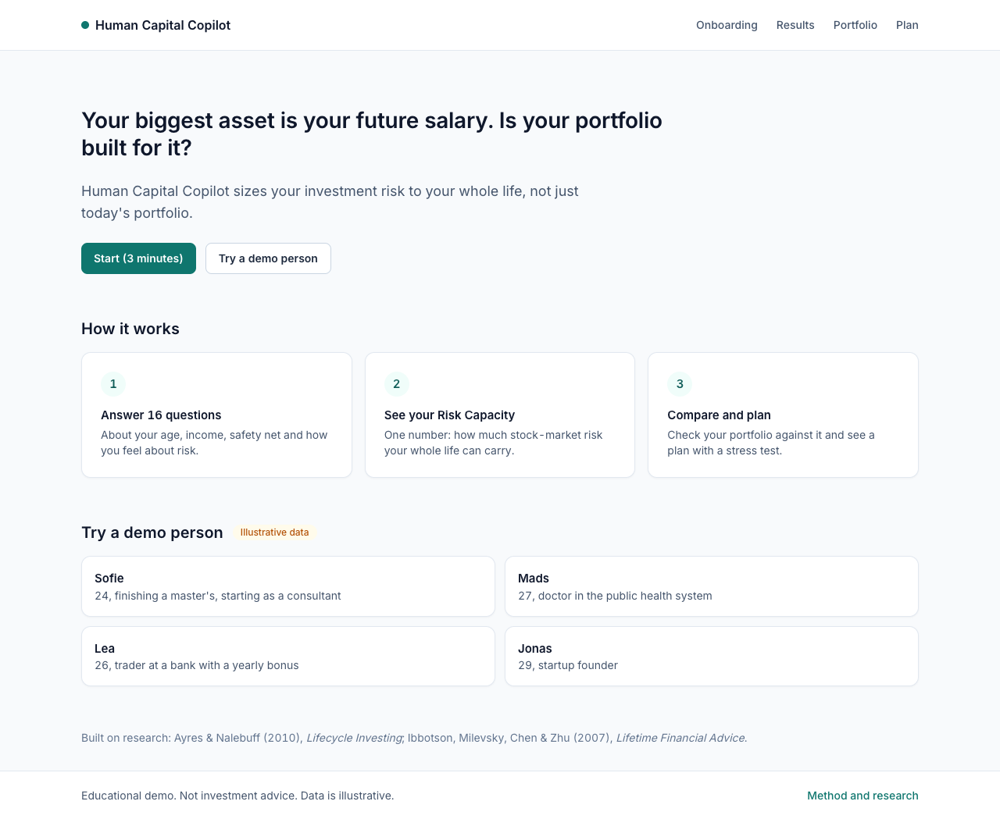
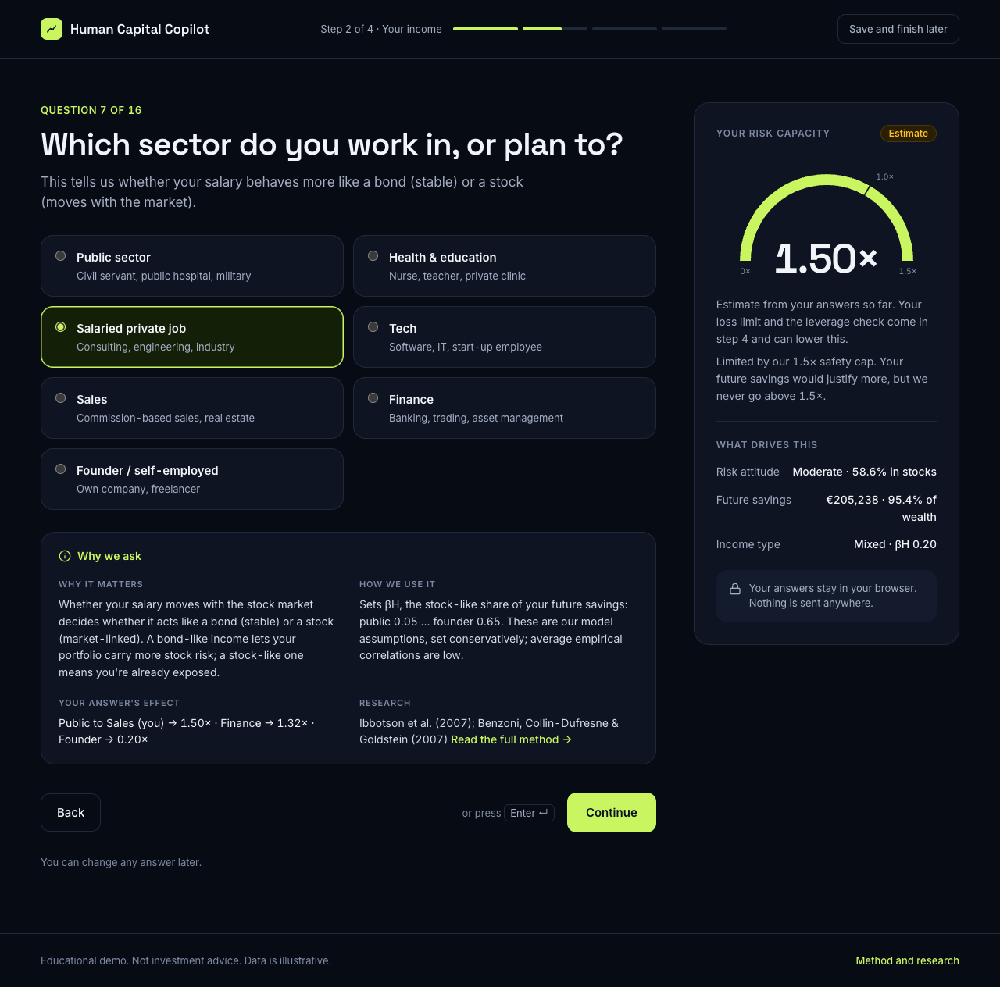
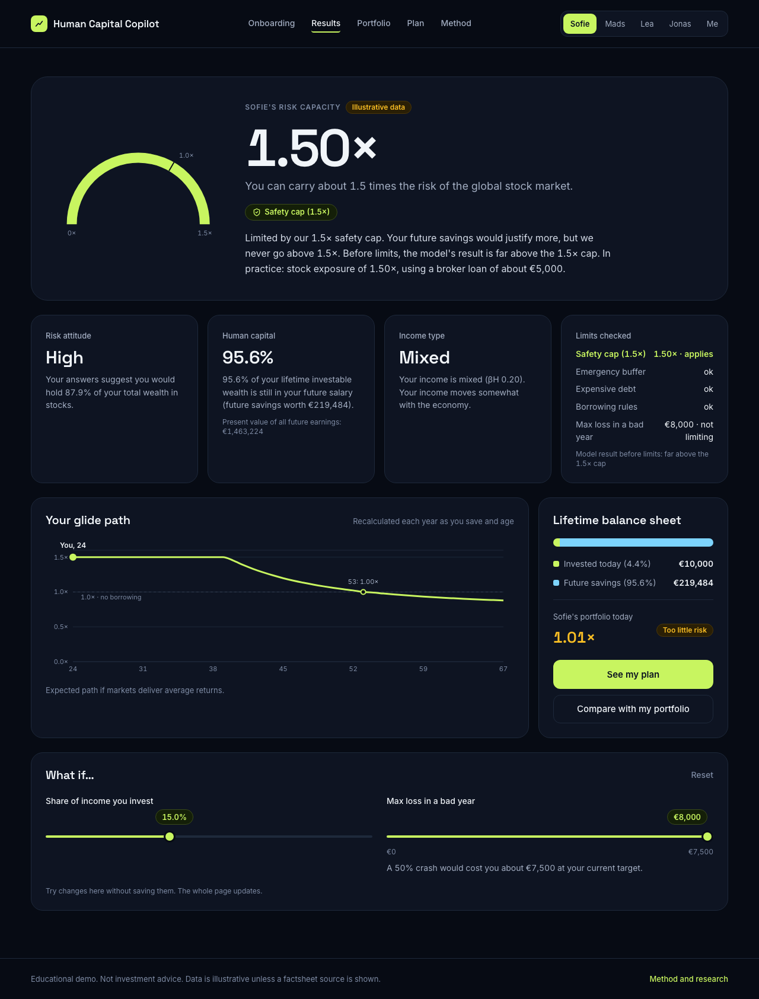
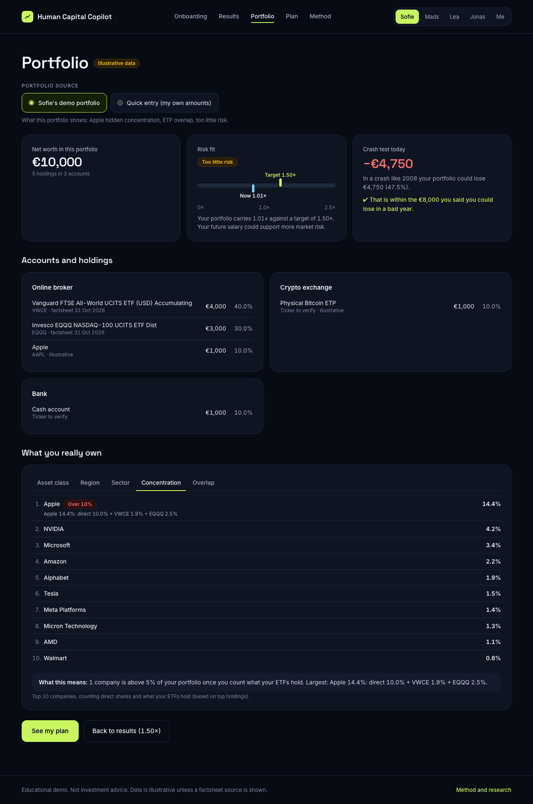
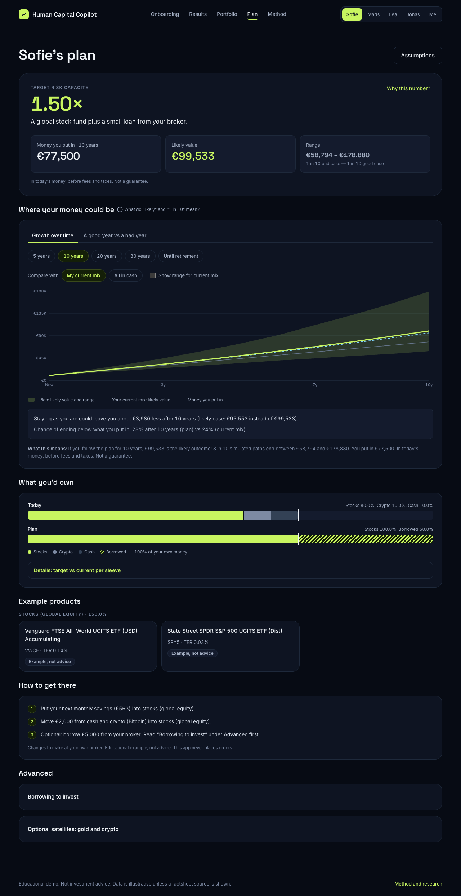
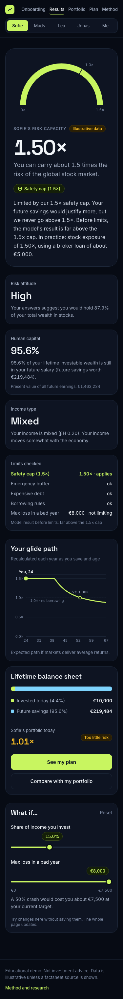
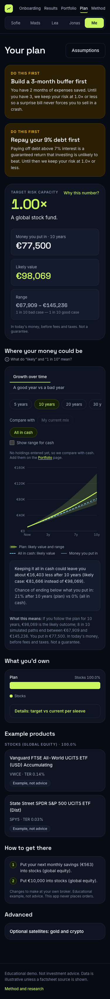

# Human Capital Copilot: application description

*14 Dec 2026 · Team: Jens, Damien, Joachim · Live demo: https://building-your-wealth.vercel.app/*

## 1. Problem

Young people are told to invest "according to their risk profile", but that profile usually looks only at the money they already have and how they feel about losses. For a 24-year-old, the money already invested is a small part of their wealth. The biggest part is **human capital**: the present value of everything they will save from their salary over their working life. For our demo person Sofie, future savings are worth about €219,000 against €10,000 invested today, so **96% of her lifetime investable wealth is still in her future salary**.

That matters for risk, in two directions:

- If your income is safe and **bond-like** (a doctor in the public health system), your salary already works like a large bond holding. Your portfolio can carry more stock-market risk.
- If your income is **stock-like** (a bank trader with a bonus, a startup founder), your salary falls in the same crashes as the stock market. Your portfolio should carry less.

Standard risk questionnaires miss both effects. Young people with safe jobs often hold too little risk (lots of cash), while people in finance often double up on the same risk.

Today's tools don't close this gap:

- **Portfolio trackers look backwards.** They show what you own, not whether that risk fits your life.
- **Robo-advisor questionnaires mostly ask about willingness, not capacity.** A review of the risk questionnaires of 30 robo-advisors in seven Asia-Pacific economies found that risk-tolerance questions outnumber risk-capacity questions (Lai & Chow, 2023). Future earnings and job risk, the core of capacity, are rarely measured.
- **AI chatbots are not a substitute.** Their advice can change with how a question is worded, and it is hard to check. That is why every number in this app comes from tested formulas, and the explanations are fixed templates filled with those numbers.

Robo-advice can help: in one study it left investors who started out under-diversified with better-diversified portfolios (D'Acunto, Prabhala & Rossi, 2019). But borrowing to invest amplifies losses, so the app offers decision support with explicit risk explanations, not financial advice.

## 2. Solution

*Know what you own. Know how much risk to take.* (The product was presented as "Headroom" in the team's pitch; the app is called Human Capital Copilot.)

Human Capital Copilot turns 16 questions into one number, **Risk Capacity**: how much risk your portfolio can carry, as a multiple of the global stock market (1.00× = 100% in a global stock index fund; 1.50× = the most we ever suggest, using a broker loan). The app then:

1. **Explains** the number in plain language: which limit applies, how much of your wealth is future salary, and whether your income is bond-like or stock-like.
2. **Compares** it with your actual portfolio, looking through your ETFs to the companies, regions and sectors you really own.
3. **Shows a plan:** where your money could be in 5 to 30 years with the target plan versus your current mix, always with the 1-in-10 bad and good cases; a good year, a typical year and a 2008-style bad year against the loss you said you could live with; and the changes to make at your own broker, with example products labelled "Example, not advice".

## 3. Innovation

- **Whole-life risk sizing for ordinary users.** The lifecycle-investing research (Ayres & Nalebuff 2010; Ibbotson et al. 2007) is turned into a 3-minute questionnaire with a live gauge that moves with every answer. It is marked "Preliminary" until every question is answered.
- **Show, don't tell.** Every question has a "Why we ask" panel with the reason, how the answer is used, the research behind it and a live line computed by the engine, for example "Retiring 2 years later would add €5,274 to your future savings, but your target stays at 1.50× because it is limited by our 1.5× safety cap."
- **Income type changes the answer.** The same age, savings and risk attitude give very different results for a doctor and a trader, because the app measures how stock-like each income is (βH).
- **Safety built into the number.** A 1.5× policy cap, gates for missing emergency savings and expensive debt, a knowledge check before borrowing, and a cap based on the user's own maximum loss.
- **Look-through of ETFs.** The app shows hidden concentration (Sofie owns 14.4% Apple across a stock and two ETFs) and overlap between ETFs (VWCE and EQQQ share 20.5% of their top holdings, using the issuers' October 2026 factsheets).
- **Transparent and deterministic.** Every number comes from tested formulas, and every assumption is shown in an Assumptions table. There is no AI chat and no AI-generated numbers.

## 4. Users and personas

Students and young professionals (roughly 20–35) who have started investing or are about to. Four demo people let anyone try the app without typing:

| Person | Story | Risk Capacity | Why | Their demo portfolio |
|---|---|---|---|---|
| Sofie, 24 | Finishing a master's, starting as a consultant | **1.50×** | Limited by the 1.5× safety cap | 1.01×: too little risk; hidden Apple concentration and ETF overlap |
| Mads, 27 | Doctor in the public health system | **1.20×** | Limited by the most he could lose in a bad year | 0.20×: mostly cash, far below target |
| Lea, 26 | Trader at a bank with a yearly bonus | **0.34×** | Her income is already stock-like (βH 0.61) | 0.81×: too much risk; finance job *and* finance-heavy portfolio |
| Jonas, 29 | Startup founder | **0.67×** | Limited by the most he could lose in a bad year | 2.39×: far too much risk (60% Bitcoin) |

## 5. Features

| Page | What it does | Screenshot |
|---|---|---|
| Landing | Hero, "Start (3 minutes)", demo people, how it works, research basis | `screenshots/desktop-landing.png` |
| Onboarding | Currency choice first (DKK, EUR, USD, GBP, SEK, NOK, CHF; preselected from the browser language), then one question per screen (16 screens in 4 steps, Enter to continue); money questions as a typed field plus a logarithmic slider + review with edit links; a "Why we ask" card with research and a live effect line on every question; live Risk Capacity panel with an "Estimate" / "Preliminary" chip and the three drivers (a bottom bar that opens as a sheet on phones); "I'm not sure" on three questions; knowledge check and borrowing opt-in | `screenshots/desktop-onboarding-7.png`, `screenshots/desktop-onboarding-1.png`, `screenshots/mobile-onboarding-2.png` |
| Results | Risk Capacity, the limit that applies, four drivers, lifetime balance sheet, glide path, what-if sliders | `screenshots/desktop-results-sofie.png`, `screenshots/mobile-results-sofie.png` |
| Portfolio | Demo portfolio or quick entry; risk fit; crash test; look-through by asset class, region, sector, concentration, overlap | `screenshots/desktop-portfolio-sofie-conc.png`, `screenshots/mobile-portfolio-sofie.png` |
| Plan | Safety gates; plan summary (target, likely value and range); growth fan chart (plan vs current mix or cash, 5–30 years or until retirement) with an adaptive callout and the odds of ending below what you put in; good, typical and bad year; what you'd own today vs the plan; example products; numbered "how to get there" checklist; borrowing panel and satellites under Advanced; Assumptions | `screenshots/desktop-plan-sofie.png`, `screenshots/mobile-plan-gates.png` |
| Method | For the examiner: the five calculation steps with Sofie's worked example (computed live by the engine), every assumption with a one-line justification, the limits and gates, limitations and full references | `screenshots/desktop-method.png` |

The app works on phones (375 px) and desktops, saves answers in the browser (no login), and needs no backend. The design follows a written design system (BUILD_SPEC section 15, v1.3): a dark interface (near-black background, layered surfaces and 1px borders instead of shadows), one lime accent for the user's own number and actions, sky blue for future savings and values below 1.0×, amber for warnings, Space Grotesk for headings and big numbers and Inter for text, with tabular figures throughout. The team approved three mockups (landing, onboarding question, results) on a design canvas; the app rebuilds them with its own components. Colour pairs pass WCAG AA, and Lighthouse (12.6.1, re-measured on the live site on 28 Nov 2026) rates accessibility 100 on every page (Landing, Onboarding, Results, Portfolio, Plan and Method, with a demo person loaded on the last three, on phone and desktop). After the Plan redesign (spec v1.7) the Plan page was re-measured locally with Lighthouse 12.8.2: still 100 on phone and desktop.

### Screenshots

*Landing page: the promise, the demo people and how it works.*

*Onboarding: one question per screen with a "Why we ask" card, and the live Risk Capacity panel on the right.*

*Results (demo person Sofie): Risk Capacity 1.50×, the limit that applies, the four drivers, the glide path and the lifetime balance sheet.*

*Portfolio: risk fit, crash test and ETF look-through. Apple is 14.4% of Sofie's portfolio once her ETFs are counted.*

*Plan: the summary with the likely value and range after 10 years, and the growth chart comparing the plan (lime band) with Sofie's current mix (dashed sky line).*

 

*On a phone (375 px): Results, and the Plan with both safety gates (emergency buffer and expensive debt) active.*

## 6. Method

All human-capital maths is in real (inflation-adjusted) terms. The full specification is in `BUILD_SPEC.md` section 5, and all values are in `src/engine/assumptions.ts`.

1. **Risk attitude.** The average of two questions (reaction to a 30% fall; a job gamble) gives a risk band and a risk aversion γ (1.75 to 7). The optimal share of total wealth in stocks follows Merton (1969): **w\* = min(ERP / (γ·σ²), 1)**, with ERP = 4.5% and σ = 16%.
2. **Human capital.** Future savings are projected from today's income, growing at the user's expected rate (capped at 12% a year in the calculation; the user may enter any figure and sees a notice above 12%) until age 45 and 0.5% a year after, and discounted at the real risk-free rate (1%) plus a spread for income security (1–4.5%): **H = Σ savingsRate · yₐ / (1+d)^(a−age)**.
3. **Income type.** βH = sector base (0.05 public … 0.65 founder) + 0.3 × variable-pay share, capped at 0.9.
4. **Risk Capacity.** Stocks the investor should hold across financial wealth F and human capital H, expressed relative to F: **raw = (w\*·F + (w\* − βH)·H) / F**. Stock-like income (high βH) lowers the result, bond-like income raises it.
5. **Limits, in order:** policy cap 1.5×; 1.0× without a 3-month buffer; 1.0× with debt above 7%; 1.0× unless borrowing is allowed (15+ years to retirement, at least €5,000, knowledge check passed, opted in, and borrowing cheap enough); and a loss cap = max loss ÷ (50% × F). The final value is the raw value capped by the lowest limit, with a floor of 0.2×.
6. **Allocation.** The target is turned into weights for stocks, bonds, gold and Bitcoin with the same volatility (target × 16%), solved by bisection using a fixed correlation matrix. Weights above 100% stocks mean a broker loan.
7. **Portfolio checks.** Actual risk = portfolio volatility ÷ 16%; crash test = equity −50%, Bitcoin −75%, bonds +3%, gold +5%; look-through via ETF top holdings; risk fit is "on target" within ±0.15×.

8. **Projections (Plan page).** The plan and the current mix get an expected real return (each asset's expected return minus 2% inflation; a broker loan costs 4.5% a year) and a volatility from the same covariance matrix. 5,000 yearly log-normal paths from a fixed seed, with monthly savings added, give the likely value (median) and the 1-in-10 bad and good cases (10th and 90th percentiles) at every horizon. The one-year "bad year" is the same 2008-style crash test, so it matches the loss limit.

9. **Currency.** Every amount is shown in the currency the user picks. Demo data and the money thresholds (the €5,000 borrowing minimum, defaults, slider ranges) are stored in euros and converted at fixed ECB reference rates (17 Nov 2026). The model works with ratios, so the Risk Capacity is identical in every currency; a test checks this for all four personas in all seven currencies.

**The research does not all point one way.** If your income doesn't move with the stock market, it works like a bond, so workers should hold more stocks than retirees (Viceira, 2001) and the stock share should fall with age (Cocco, Gomes & Maenhout, 2005). But if wages and stock returns move together over the long run, a young worker's human capital is already stock-like, and the best stock share for the young can be close to zero (Benzoni, Collin-Dufresne & Goldstein, 2007). Income type therefore matters, which is why the app asks about sector, variable pay and job security and turns them into βH, instead of assuming every young person should take more risk. Leveraged ETFs are only shown as an alternative to a broker loan, with a warning that daily resetting makes long-run returns differ from the stated multiple (Avellaneda & Zhang, 2010; Cheng & Madhavan, 2009).

**An honest range, not a sales pitch.** A projection invites optimism, so the Plan page never shows a single line. The likely value always appears next to the 1-in-10 bad case, with the chance of ending below the money paid in, and every number is labelled "in today's money, before fees and taxes, not a guarantee". The comparison works both ways: for Mads (mostly cash) the chart shows what staying cautious may cost, and for Jonas (mostly Bitcoin) it shows that his bad case ends far below what he put in. Losses are amber, and red is used only when a loss exceeds the user's own limit. This keeps the page fair and balanced, as suitability and marketing rules expect, while still leading with what a beginner wants to know: where the money could be in ten years.

**Product data.** Five example products (VWCE, SPY5, EQQQ, AGGH, PHAU) use verified data from the issuers' factsheets (31 Oct 2026; PHAU 30 Oct): fees, top 10 holdings, and country and sector weights. Each product's source and date are listed on the Method page. All other product data is illustrative and marked as such.

**Testing.** 342 automated tests reproduce every expected value in the specification (all four personas, demo portfolios, allocations, crash tests, glide path, gate cases), check the projections (exact compounding without volatility, the simulated median against the analytic formula, a fixed seed giving identical results, the bad-year tile matching the crash test) and check the pages themselves. Engine coverage is about 99% of lines.

## 7. How AI was used in development

The app was built with **Claude Code** (Anthropic's coding agent) working from a written specification, `BUILD_SPEC.md`, which the team developed with Claude in a design phase (see `prompts/design-phase-log.md`).

- **Spec first, then phases.** The build was split into 7 phases (setup, engine, data, three page phases, polish). Each phase had acceptance criteria, and the agent planned before building.
- **Every prompt is logged.** A small hook in the project (`.claude/hooks/log-prompt.mjs`) automatically saves every prompt verbatim to `prompts/PROMPT_LOG_AUTO.md`. `prompts/PROMPT_LOG.md` records what the AI did, which files changed, test results, what the human checked and the lesson from each task.
- **Numbers are never trusted, they are tested.** The spec lists exact expected values (for example Sofie 1.50×, Lea 0.34×, Apple 14.4%). The AI wrote tests that reproduce them before any page used them.
- **The AI found its own mistakes through tests and checks,** for example a floating-point error at the exact ±0.15 risk-fit boundary, a rounding issue that showed Apple at 14.3% instead of 14.4%, a component that would have reset the open tab while typing, and wording that pointed to a panel "below" when it was above.
- **A design system as a spec.** The first build worked but looked unpolished. Instead of asking for "nicer", the team wrote exact design rules (tokens, sizes, components) and research-backed help text into the spec (v1.2), and the AI rebuilt the layout against them, then checked the result at phone and desktop width.
- **Mockups as the target.** For the final redesign (spec v1.3) the team approved three static mockups and asked the AI to rebuild them with the app's own components, not copy them. Onboarding changed from four questions per page to one question per screen, while the engine and all 190+ tests stayed unchanged. The AI compared its screenshots side by side with the mockups and fixed the differences it found (for example buttons that wrapped in a narrow card).
- **Automated browser checks.** The AI drove a headless Chrome to load every page at phone and desktop width, check for console errors and sideways scrolling, and review screenshots. This found a table that was too wide on phones and a chart warning, which were fixed. Once, the check itself was wrong: it seemed to show onboarding losing saved answers, but the cause was the test script reusing an old page in memory. The AI traced this before changing any app code.
- **Team prompts.** Damien's prompts (pitch, demo data, his description draft) are in `prompts/team/damien.md`: his original prompts, verbatim and mostly in French, followed by an English summary.
- **Humans decided.** Joachim approved every plan, every dependency outside the agreed stack, every commit and every push, and checked the result in the browser.

## Team contributions

The product idea was developed and registered by the whole team.

- **Joachim Uldahl**: product specification and the human-capital risk model (methodology, formulas, assumptions and validation of the reference values); the full build of the application with Claude Code, including design iterations, tests, deployment on Vercel and the automated prompt logging; integration of the team's inputs; this document, the README and the submission package.
- **Damien**: pitch deck and presentation script; co-presented the initial pitch; verified ETF demo data extracted from 10 official factsheets (now used for five of the app's products), three example users, and the first draft of the application description, including the evidence on robo-advisors and the research that challenges the approach.
- **Jens**: co-presented the initial pitch.

## 8. Limitations

- **Partly illustrative data.** Five products use verified factsheet data; the financials ETF, short government bonds, Bitcoin ETP, 2× leveraged ETF, single-stock details, the demo people and their portfolios are illustrative. Look-through and overlap use only each ETF's top 10 holdings, and VWCE's factsheet lists only its top 10 countries (the rest is shown as "Other countries").
- **Judgement-based income betas.** How stock-like each sector's income is (βH) is a conservative model assumption, not an estimate from data.
- **Simplified model.** Fixed return, volatility and correlation assumptions; no taxes, fees, inflation scenarios or currency risk (FX rates are fixed and only used for display and thresholds); the crash test is one historical-style scenario, not a forecast.
- **Projections are scenarios, not forecasts.** Constant expected returns, yearly steps, savings constant in today's money and the target held constant over the horizon (no glide path in the projection); no fees or taxes.
- **Income model.** One growth rate until 45, then 0.5% a year; no career breaks, unemployment or pensions.
- **Not advice.** The app shows sleeve weights and example products for education. It never gives buy or sell instructions and never places orders.
- **Local only.** Answers are stored in the user's browser and are not shared between devices.

## References (in addition to the Method page)

- Avellaneda, M. & Zhang, S. (2010). Path-dependence of leveraged ETF returns. *SIAM Journal on Financial Mathematics*, 1, 586–603.
- D'Acunto, F., Prabhala, N. & Rossi, A. G. (2019). The promises and pitfalls of robo-advising. *Review of Financial Studies*, 32(5), 1983–2020.
- Lai, T. Y. & Chow, Y. P. (2023). An evaluation of robo-advisor risk assessment questionnaires in selected Asia Pacific economies. *Tra Vinh University Journal of Science*, 13(3). doi:10.35382/TVUJS.13.3.2023.2428

All other works cited (Viceira; Cocco, Gomes & Maenhout; Benzoni, Collin-Dufresne & Goldstein; Cheng & Madhavan; Ayres & Nalebuff; Ibbotson et al.) are listed in full on the Method page.
